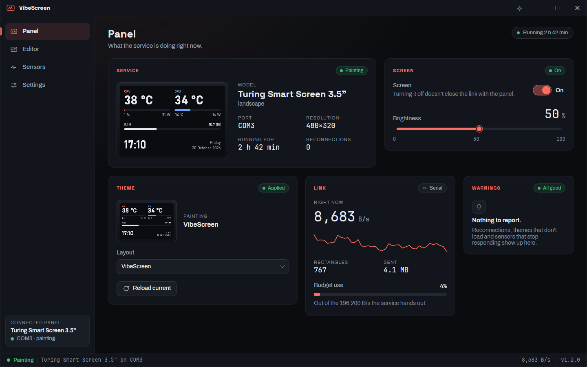
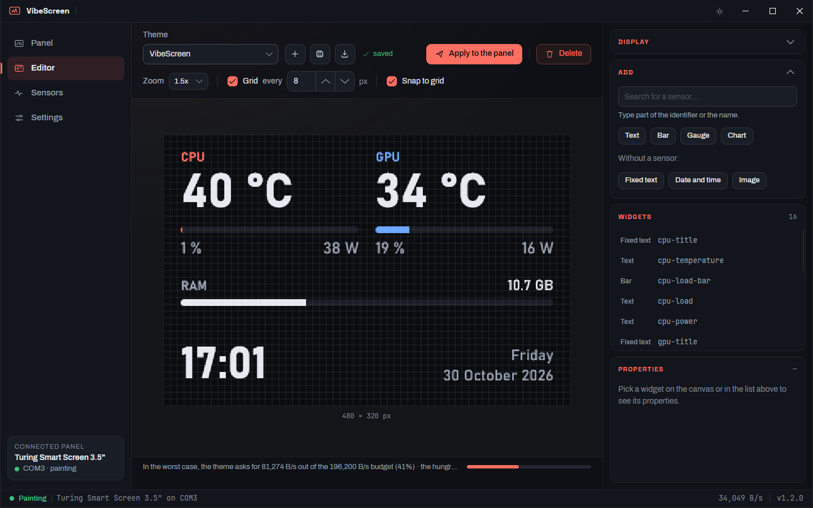
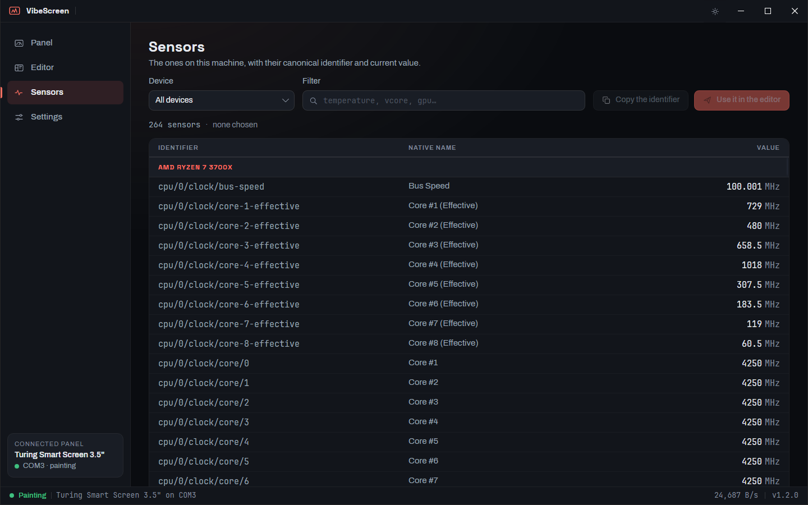
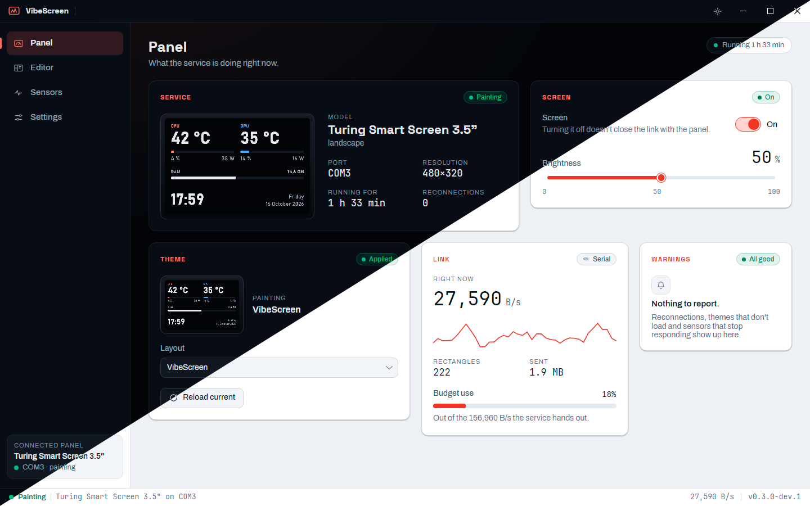

<div align="center">


# VibeScreen

**Turn your USB smart screen into a live hardware dashboard.**
Design it in a visual editor, set it once, and forget about it: it keeps running in the background.

[](https://github.com/sergiosahuquillo/vibescreen/releases/latest)
[](https://github.com/sergiosahuquillo/vibescreen/releases)
[](https://github.com/sergiosahuquillo/vibescreen/actions/workflows/build.yml)
[](../LICENSE)


[](https://github.com/sergiosahuquillo/vibescreen/releases/latest)
[](https://sergiosahuquillo.github.io/vibescreen/)



</div>

## Why VibeScreen

- **No window needed.** The screen is driven by a small Windows service that starts with your PC and
  keeps going with the app closed. Open the window only when you want to change something.
- **What you see is what you get.** The editor preview isn't a mock-up: it's drawn by the same renderer,
  pixel for pixel, that feeds your screen.
- **Smooth on a slow cable.** These screens move about 256 KB/s. VibeScreen only redraws what changed and
  plans every frame within that budget, so your widgets update without stutter, and the editor tells you
  in advance how much of the link a theme will need.
- **Themes that travel.** Sensors have neutral names, like `cpu/0/temperature/package` or
  `gpu/0/load/core`, so a theme made on an AMD machine works the same on an Intel or NVIDIA one.
- **Free and open source**, under the GPL-3.0.

## Features

### A visual theme editor

Drag and resize widgets on a pixel grid with snap and zoom, and set every property from a side panel.
Duplicate, copy and paste widgets, even between themes. A background can be a color or an image.



- **Five widget types**: text and values, bars, gauges and rings (with the value written inside),
  scrolling charts, and clocks with date formats.
- **Color by value**: green, amber and red, or any three colors you like, with your own thresholds.
  You can see a hot CPU without reading the number.
- **Units your way**: °C or °F, MHz or GHz, MB/s or Mbit/s, with as many decimals as you need.
- **Self-contained themes**: each theme is a folder that holds its own background image, so you can
  copy it to another PC or share it. Import themes someone sends you.
- **A random theme on every start**, if you can't pick just one.

### Hundreds of sensors

CPU, GPU, memory, storage, network, motherboard and fans, each with its canonical identifier and its
live value. Filter them by device or by text, and send one straight to the editor.



### Built to be left alone

- Starts with Windows, and if you unplug the screen, it reconnects by itself when it comes back.
- Brightness and screen on/off from the app, remembered across restarts.
- Lives in the system tray when you close the window.
- Dark and light modes (or follow Windows), eight accent colors, in English and Spanish.



## Supported screens

| Screen | Status |
|---|---|
| Turing Smart Screen 3.5" (revision A, USB ID `1A86:5722`) | ✅ Supported, portrait and landscape |
| Other sizes and revisions (B, C, D) | 🛠️ Planned |

Got a different model? [Open an issue](https://github.com/sergiosahuquillo/vibescreen/issues) with its
name and revision.

## Install

1. Download `VibeScreen-<version>-setup.exe` from the
   [latest release](https://github.com/sergiosahuquillo/vibescreen/releases/latest).
2. Run it. The installer isn't code-signed yet, so Windows SmartScreen may say
   *"Windows protected your PC"*: click **More info** → **Run anyway**.
3. Plug in your screen. It starts showing the default theme right away, with no window to open.

**Requirements:** Windows 10 version 1809 or later, or Windows 11, on a 64-bit PC. Nothing else to
install: .NET is included.

To update, go to **Settings → Updates** in the window: it tells you when there's a new version and
installs it with one click (Windows asks for administrator permission). If you'd rather it didn't look,
choose *Manually* or *Don't update* there. Running the new installer over the old one also works, and
either way your themes and settings stay. To uninstall, use *Installed apps* in Windows; it asks
whether to keep your themes and settings.

## FAQ

<details>
<summary><b>What is PawnIO and why does the installer add it?</b></summary>

Reading the CPU temperature and the motherboard sensors needs low-level hardware access, and Windows only
allows that through a driver. [PawnIO](https://pawnio.eu/) is that driver: open source, signed by
Microsoft, and shared with other monitoring tools such as LibreHardwareMonitor and HWiNFO. The installer
tells you before adding it, and skips it if it's already there. Uninstalling VibeScreen leaves PawnIO in
place, because other programs may be using it.
</details>

<details>
<summary><b>Does the app need to stay open?</b></summary>

No. The screen is driven by the VibeScreen service, which starts with Windows. The window is only for
setting things up, and it doesn't start with Windows on purpose: once your theme is set, there's no
reason to keep it running.
</details>

<details>
<summary><b>Why does it ask for administrator rights?</b></summary>

Only the installer does, to set up the service and the sensor driver, and so does every update
installed from the window, because it runs that same installer. The window itself runs as a normal
user.
</details>

<details>
<summary><b>Some widgets show <code>--</code>. Why?</b></summary>

That sensor doesn't exist on your PC. For example, a GPU widget on a machine without a dedicated
graphics card. Pick another sensor for it in the editor.
</details>

<details>
<summary><b>Does it run on Linux?</b></summary>

Not yet: the sensor backend is Windows-only for now. Linux support is planned.
</details>

## Build from source

You need the .NET 10 SDK on Windows. Run the service from an administrator console, which is what gives
it access to the sensors, and the app from a normal one:

```bash
dotnet build
dotnet run --project src/VibeScreen.Service -f net10.0-windows
dotnet run --project src/VibeScreen.App
```

The developer documentation, covering the architecture and how releases are made, is in the
[main README](../README.md). The reasoning behind each design decision is
in the [design notes](../docs/design-notes.md).

## Credits

- [turing-smart-screen-python](https://github.com/mathoudebine/turing-smart-screen-python): the screen
  protocol comes from its reverse-engineering work.
- [LibreHardwareMonitor](https://github.com/LibreHardwareMonitor/LibreHardwareMonitor) and
  [PawnIO](https://pawnio.eu/): the sensors.
- [Avalonia](https://avaloniaui.net/) and [SkiaSharp](https://github.com/mono/SkiaSharp): the window
  and the rendering.

## License

VibeScreen is free software under the [GNU General Public License v3.0](../LICENSE).

## Star history

<a href="https://www.star-history.com/#sergiosahuquillo/vibescreen&Date">
  <picture>
    <source media="(prefers-color-scheme: dark)" srcset="https://api.star-history.com/svg?repos=sergiosahuquillo/vibescreen&type=Date&theme=dark" />
    <source media="(prefers-color-scheme: light)" srcset="https://api.star-history.com/svg?repos=sergiosahuquillo/vibescreen&type=Date" />
    
  </picture>
</a>
